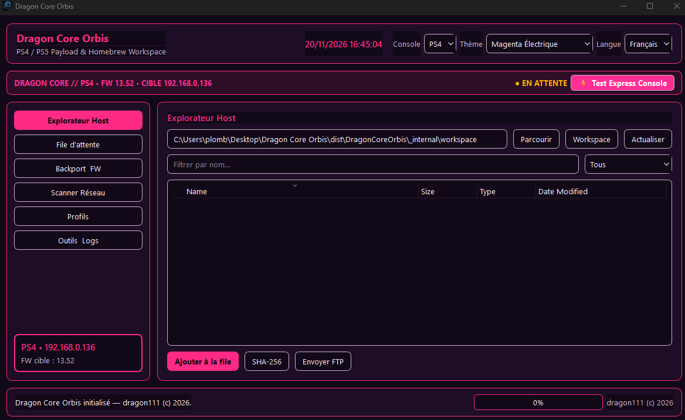
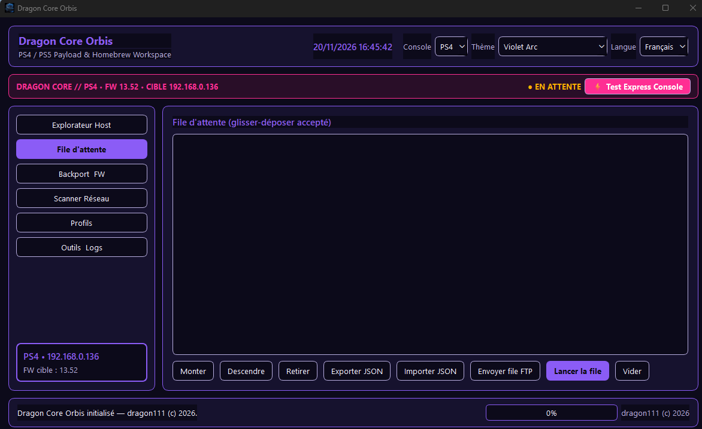
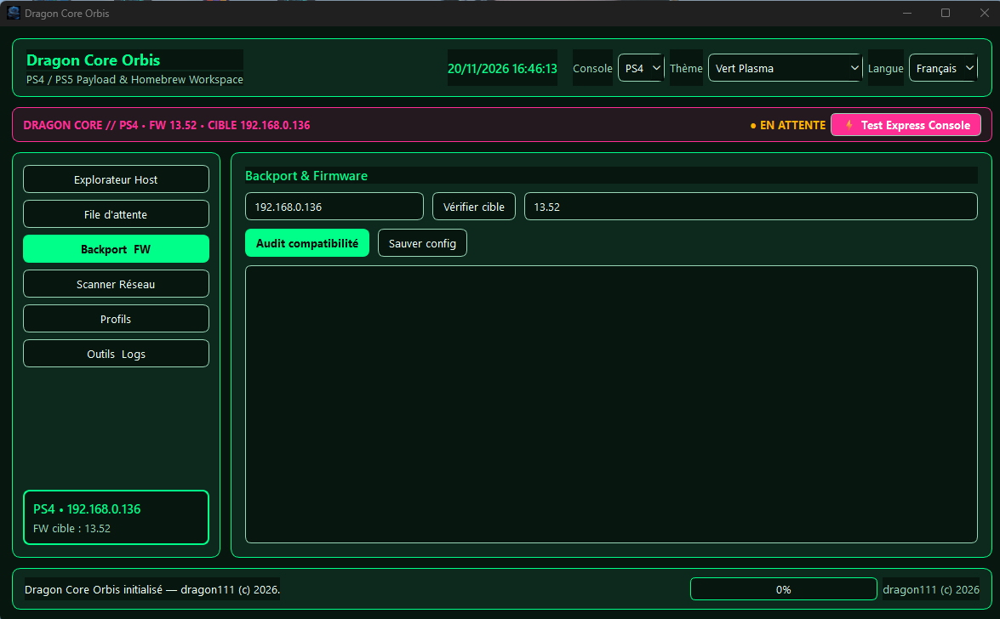
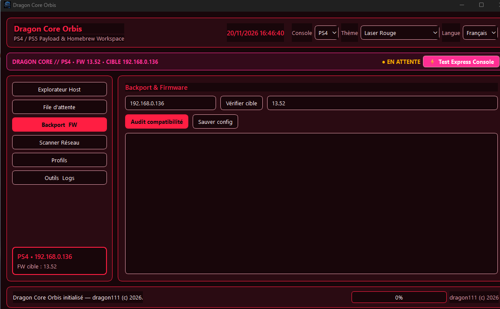
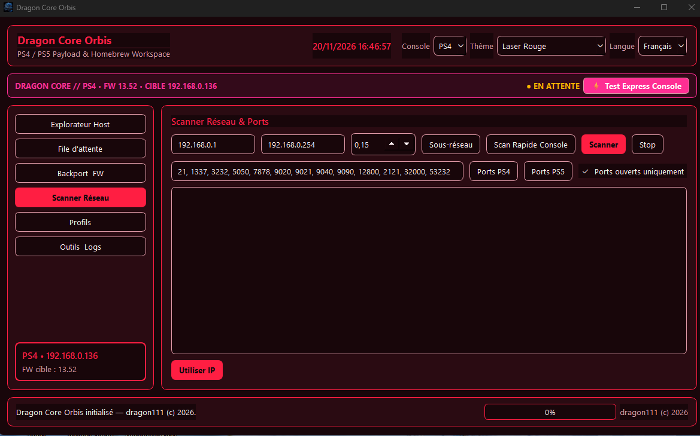
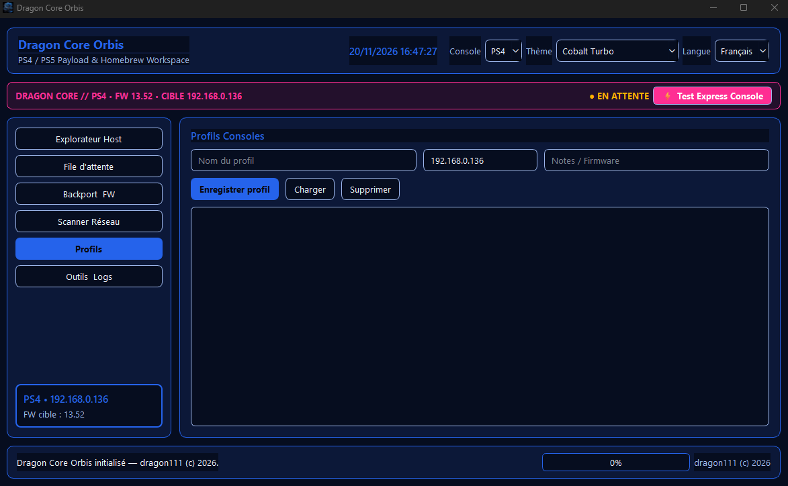
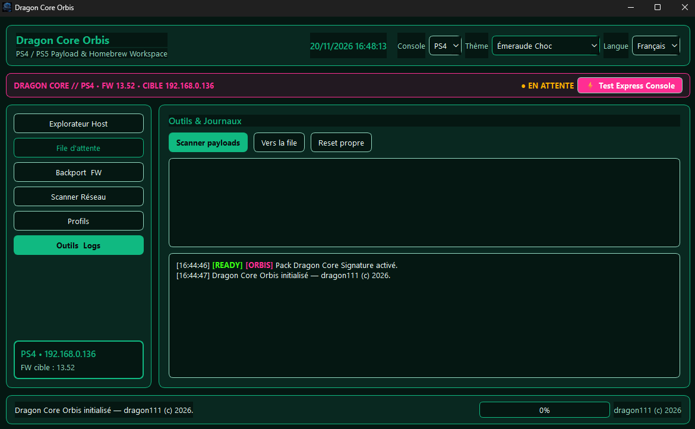

# Dragon Core Orbis

Application Windows en Python conçue pour offrir une interface fluide, des thèmes électriques personnalisables (dont les combinaisons bleu électrique, orange électrique et gris métallique), un scanner réseau multi-thread et une gestion persistante des files d'attente et paramètres.

## Aperçu en images









## À quoi servent les options

* **Thèmes électriques :** permettent de changer l'ambiance visuelle de l'interface en un clic (dont **Bleu & Orange Électrique** et **Orange & Bleu Électrique** sur fond gris sombre).
* **Scanner réseau multi-thread :** analyse le réseau sans figer l'interface et propose des actions rapides dans la console.
* **File d'attente persistante :** conserve les éléments en cours ou à traiter, avec réorganisation par glisser-déposer (*drag-and-drop*).
* **Sauvegarde automatique :** enregistre les réglages, profils et préférences pour les retrouver au prochain démarrage.

## Tutoriel d'utilisation et de compilation
## Mode d'emploi

1. **Réglages rapides (barre supérieure) :** choisis la **Console** (PS4 / PS5), le **Thème** électrique et la **Langue**, puis clique sur **Test Express Console** pour vérifier la connexion.
2. **Explorateur Host :** sélectionne ton dossier de travail (ou clique sur **Parcourir**), filtre tes fichiers, puis utilise **Ajouter à la file**, **SHA-256** ou **Envoyer FTP**.
3. **File d'attente :** organise tes éléments par glisser-déposer et suis l'avancement via la barre de progression en bas de l'interface.
4. **Scanner Réseau & Profils :** scanne ton réseau local depuis **Scanner Réseau** et sauvegarde tes réglages habituels dans **Profils**.
5. **Outils Logs :** consulte les journaux en cas de besoin de vérification ou de dépannage.

### Lancer l'application depuis les sources

```powershell
.venv\Scripts\python.exe run_orbis.py
